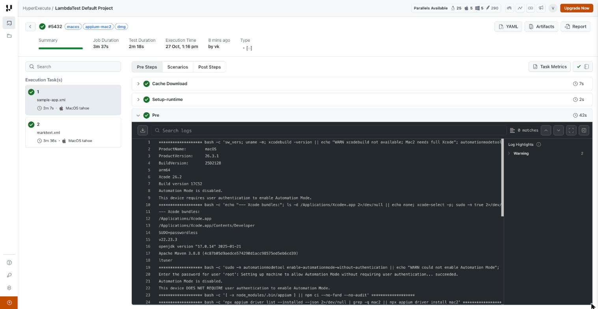
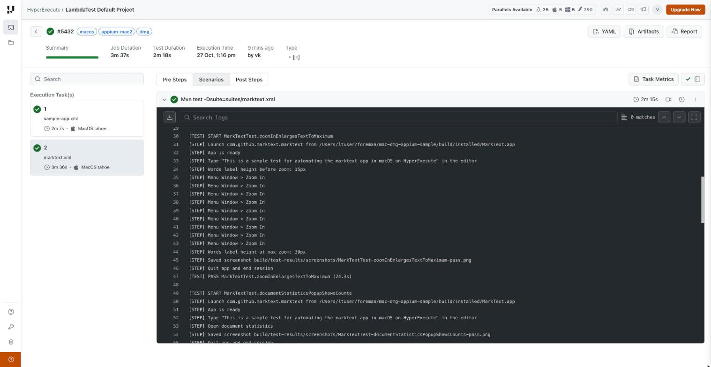
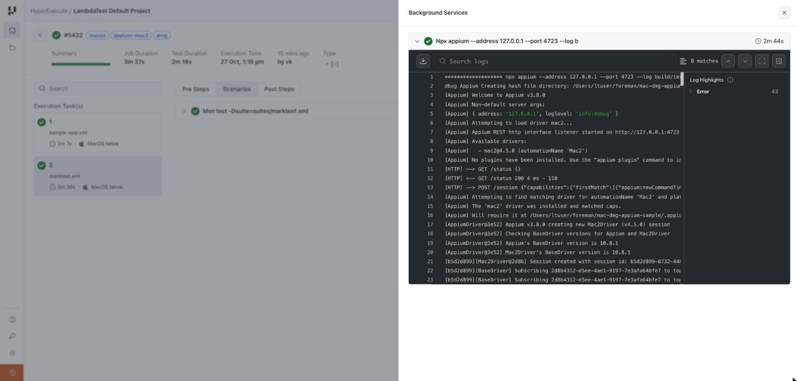
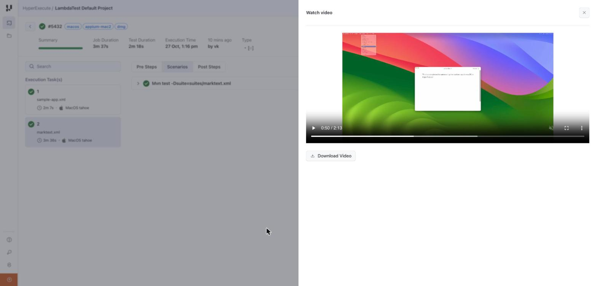
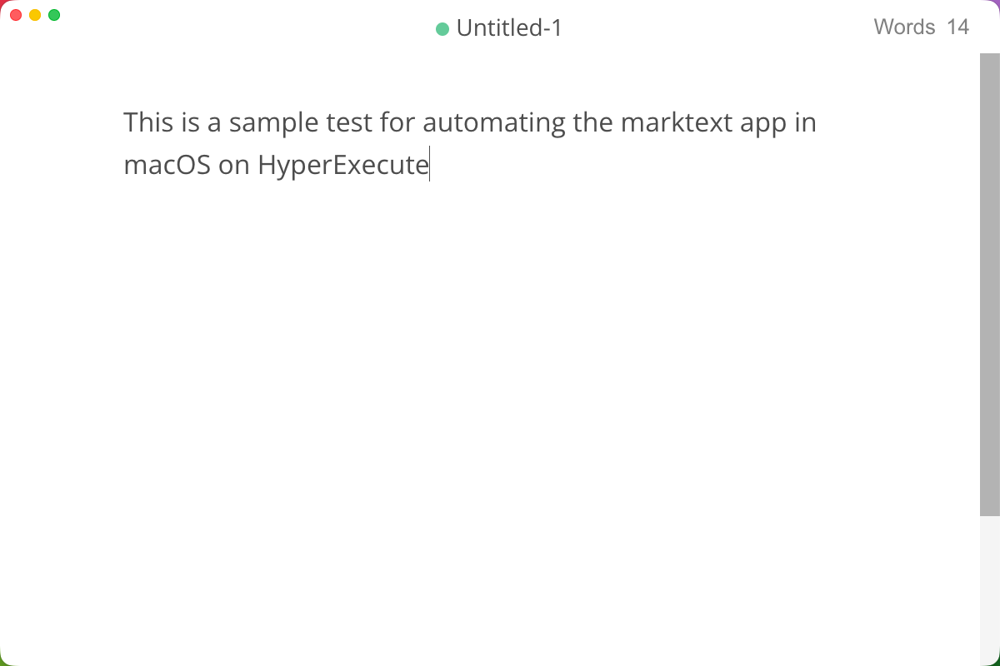
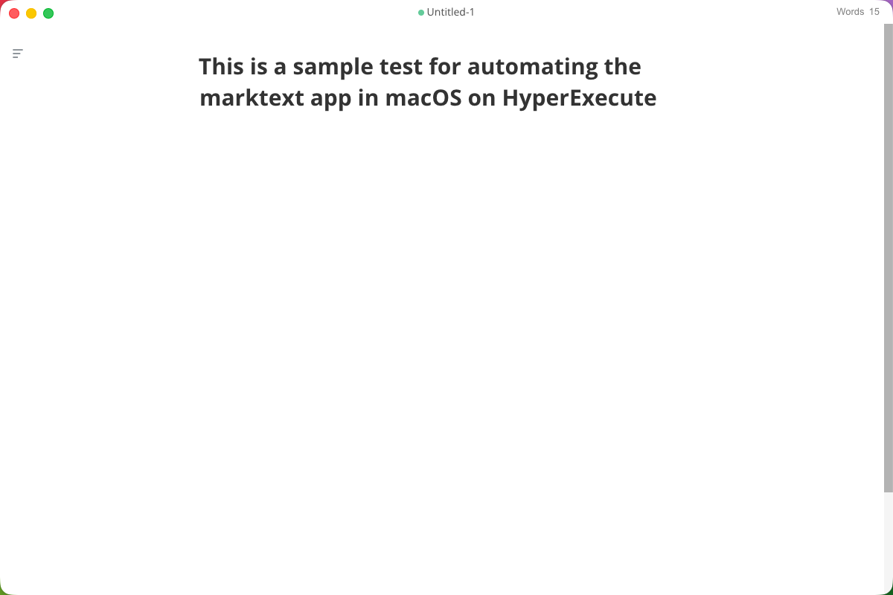
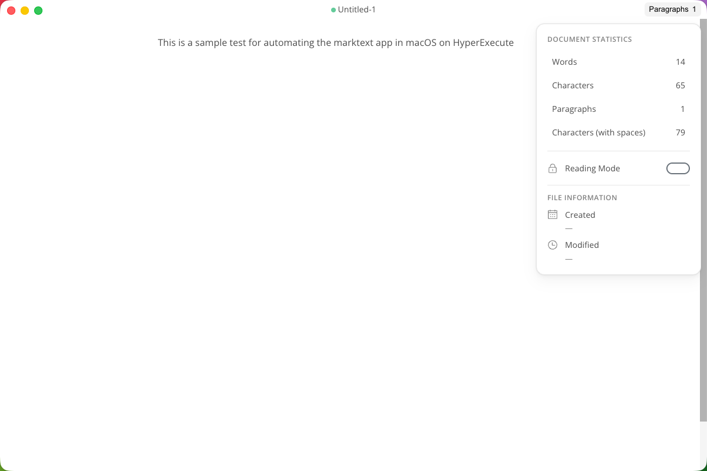
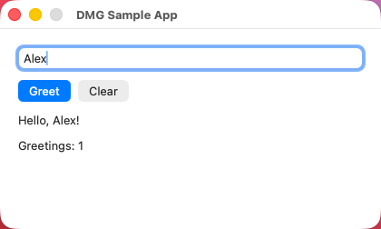

# Automating a macOS `.dmg` app on HyperExecute

This repo is a working example of **testing a native macOS desktop app, delivered as a `.dmg`,
on [HyperExecute](https://www.testmuai.com/support/docs/getting-started-with-hyperexecute/)**. It uses Java + TestNG + Appium Mac2, and it passes end to end on HyperExecute's
macOS Tahoe runners.

In one job, HyperExecute:

1. installs the apps from their `.dmg` files (one built in the job, one downloaded from a URL),
2. starts an Appium Mac2 server in the background on the runner,
3. runs the TestNG tests against the real app windows,
4. uploads screenshots, the Appium log and the TestNG reports as artifacts.

```
 pre                                   background              testSuites            artifacts
 ─────────────────────────────────     ─────────────────────   ───────────────────   ─────────────────────
 enable Automation Mode                npx appium (Mac2)  ◄──  mvn test              screenshots/
 npm ci + mac2 driver   (cached)       on 127.0.0.1:4723       -Dsuite=<suite>.xml   appium.log
 build / download .dmg                                                               surefire-reports/
 mount .dmg → copy .app → detach                                                     screen recording
```

**HyperExecute docs used in this repo:**
[Getting started](https://www.testmuai.com/support/docs/getting-started-with-hyperexecute/) ·
[CLI](https://www.testmuai.com/support/docs/hyperexecute-cli-run-tests-on-hyperexecute-grid/) ·
[YAML reference](https://www.testmuai.com/support/docs/deep-dive-into-hyperexecute-yaml/) ·
[Matrix strategy](https://www.testmuai.com/support/docs/hyperexecute-matrix-multiplexing-strategy/) ·
[Background services](https://www.testmuai.com/support/docs/hyperexecute-background-services/) ·
[Caching](https://www.testmuai.com/support/docs/hyperexecute-how-smart-caching-boosts-tests-speed/) ·
[Artifacts](https://www.testmuai.com/support/docs/hyperexecute-artifacts/) ·
[GitHub Actions](https://www.testmuai.com/support/docs/github-actions-with-hyperexecute/)

---

## What this repo shows

| | |
|---|---|
| **App delivery** | Both ways of getting a DMG into the job: built inside the job (`scripts/build-sample-dmg.sh`) and downloaded from a URL in `pre` |
| **Apps under test** | `DMGSampleApp`: a small native AppKit app included in the repo. **MarkText**: a real third-party Electron app ([marktext/marktext](https://github.com/marktext/marktext) v0.23.0) |
| **Automation** | Appium 3.8 + `mac2` driver 4.5 (XCTest / WebDriverAgentMac), Java client 10, TestNG 7 |
| **HyperExecute features** | [`runson`](https://www.testmuai.com/support/docs/deep-dive-into-hyperexecute-yaml/#runson)`: mac26`, [matrix](https://www.testmuai.com/support/docs/hyperexecute-matrix-multiplexing-strategy/) (one VM per suite), [`background`](https://www.testmuai.com/support/docs/hyperexecute-background-services/) service, [cache](https://www.testmuai.com/support/docs/deep-dive-into-hyperexecute-yaml/#cachekey), [screen recording](https://www.testmuai.com/support/docs/deep-dive-into-hyperexecute-yaml/#capturescreenrecordingforscenarios), [artifacts](https://www.testmuai.com/support/docs/hyperexecute-artifacts/) |
| **Result** | 9/9 tests pass in about **3.5 minutes** for the whole job |

### The tests

| Suite | Test | What it checks |
|---|---|---|
| `suites/marktext.xml` | `zoomInEnlargesTextToMaximum` *(runs first)* | Types text, clicks **Window → Zoom In** until the maximum (2.0x), checks the UI doubled in size |
| | `documentStatisticsPopupShowsCounts` | Opens the statistics popup, checks the character count |
| | `launchesWithEmptyUntitledDocument` | App opens with `Untitled-1` and 0 words |
| | `nativeMenuTurnsParagraphIntoHeading` | Native menu bar **Paragraph → Heading 1** turns the line into an H1 |
| | `typingUpdatesEditorAndWordCount` | Typed text appears in the editor and the word count updates |
| `suites/sample-app.xml` | `appLaunchesWithMainWindow` | Main window is shown with its initial label |
| | `greetsEnteredName` | Type a name, click **Greet**, check the greeting and counter |
| | `showsValidationForEmptyName` | Clicking **Greet** with no name shows a validation message |
| | `clearResetsTheForm` | **Clear** resets the field and label |

The text typed into MarkText is
*"This is a sample test for automating the marktext app in macOS on HyperExecute"*.

---

## Run it on HyperExecute

### 1. Prerequisites

- A LambdaTest / TestMu AI account with HyperExecute access, and your **username and access key**
  ([where to find them](https://www.testmuai.com/support/docs/hyperexecute-environment-variable-setup/)).
- The [HyperExecute CLI](https://www.testmuai.com/support/docs/hyperexecute-cli-run-tests-on-hyperexecute-grid/#download-the-hyperexecute-cli) in the repo root (macOS shown; Linux and
  Windows builds are on the same page):

  ```bash
  curl -O https://downloads.lambdatest.com/hyperexecute/darwin/hyperexecute
  chmod +x hyperexecute
  ```

Nothing else is needed on your machine; the build and the tests run on the HyperExecute runner.

### 2. Run

```bash
export LT_USERNAME=<your username>
export LT_ACCESS_KEY=<your access key>

./hyperexecute --user "$LT_USERNAME" --key "$LT_ACCESS_KEY" \
  --config hyperexecute.yaml \
  --download-artifacts --download-logs --download-artifacts-path build/hye-artifacts/
```

Flags: [`--user`](https://www.testmuai.com/support/docs/hyperexecute-cli-run-tests-on-hyperexecute-grid/#-u---user), [`--key`](https://www.testmuai.com/support/docs/hyperexecute-cli-run-tests-on-hyperexecute-grid/#-k---key), [`--config`](https://www.testmuai.com/support/docs/hyperexecute-cli-run-tests-on-hyperexecute-grid/#--config),
[`--download-artifacts`](https://www.testmuai.com/support/docs/hyperexecute-cli-run-tests-on-hyperexecute-grid/#--download-artifacts), [`--download-logs`](https://www.testmuai.com/support/docs/hyperexecute-cli-run-tests-on-hyperexecute-grid/#--download-logs),
[`--download-artifacts-path`](https://www.testmuai.com/support/docs/hyperexecute-cli-run-tests-on-hyperexecute-grid/#--download-artifacts-path). All flags are listed in the
[CLI reference](https://www.testmuai.com/support/docs/hyperexecute-cli-run-tests-on-hyperexecute-grid/#hyperexecute-cli-supported-flags).

The CLI prints a **Job Link** to the HyperExecute dashboard and streams each stage:

```
Execution Plan
Mode:    matrix
Runson:    mac26
Concurrency:    2
Cache Directories:
    node_modules
    .appium
    .m2

✔ [1]  cache-download (8s)
✔ [1]  setup-runtime (3s)
✔ [2]  pre (37s)
✔ [1]  pre (42s)
✔ [1]  mvn test -Dsuite=suites/sample-app.xml (50s)
✔ [1]  npx appium --address 127.0.0.1 --port 4723 --log build/test-results/appium.log --log-level info:debug (1m13s)
✔ [2]  mvn test -Dsuite=suites/marktext.xml (2m16s)

 COMPLETED
    Test Execution Time:                  2m18s
    Job Duration Time:                    3m37s
    Failed Tasks:                         0
```

To check the YAML without starting a job, add [`--validate`](https://www.testmuai.com/support/docs/hyperexecute-cli-run-tests-on-hyperexecute-grid/#--validate). For the meaning of
`COMPLETED` and the other job and task states, see [HyperExecute Status](https://www.testmuai.com/support/docs/hyperexecute-status/).

### 3. What you get back

See [Job Artifacts](https://www.testmuai.com/support/docs/hyperexecute-artifacts/) for how artifacts are collected and viewed.

| Where | What |
|---|---|
| Dashboard → task → **Pre Steps** | Cache download, runtime setup and the `pre` log (runner details, app installs) |
| Dashboard → task → **Scenarios** | The Maven/TestNG log with every test step (see [Test logs](#test-logs)) |
| Dashboard → task → icon next to the ✔ status (top right) → **Background Services** | The Appium server log (see [Appium log](#appium-server-log-background)) |
| Dashboard → task → **Scenarios** → camera icon | Screen recording of the runner's desktop while the tests run |
| `build/hye-artifacts/macos-test-results/<task>/build/test-results/screenshots/` | A screenshot of the app window at the end of every test, named `<Class>-<test>-<pass\|fail>.png` |
| `build/hye-artifacts/macos-test-results/<task>/build/test-results/appium.log` | Full Appium debug log |
| `build/hye-artifacts/macos-test-results/<task>/target/surefire-reports/` | TestNG HTML and XML reports |
| `logs/<jobId>/` | Every stage's console log (`pre`, `background`, scenarios) |

### On the HyperExecute dashboard

**Job page, Pre Steps.** One task per suite (both on MacOS Tahoe), the stage timings, and the `pre` log
showing macOS 26.3.1, Xcode 26.2 and Automation Mode being enabled:



**Scenarios: test steps.** The `mvn test` log for the MarkText task, with the zoom test's steps:



**[Background Services](https://www.testmuai.com/support/docs/hyperexecute-background-services/): Appium.** Open it with the icon next to the green ✔ at the top right of the
task. The "Error" count under *Log Highlights* is the tests polling for elements while the app is
still rendering (`no such element` replies); those are expected and are not failures.



**Screen recording** ([`captureScreenRecordingForScenarios`](https://www.testmuai.com/support/docs/deep-dive-into-hyperexecute-yaml/#capturescreenrecordingforscenarios)). The camera icon on the scenario opens the video of the runner's screen. This
frame, 50s in, shows the **Window** menu open on **Zoom In** while the text gets bigger. The first
part of the video shows just the desktop while Maven starts and Mac2 builds WebDriverAgentMac.



---

## Screenshots taken by the tests

These were taken **on the HyperExecute runner** by the tests themselves (job `fc2721cd`) and are
uploaded as artifacts.

**MarkText at maximum zoom** after nine clicks on Window → Zoom In. The `Words` label measured 15px before and 30px after:



**MarkText, native menu Paragraph → Heading 1**:



**MarkText document statistics popup** (14 words, 65 characters):



**DMGSampleApp** after typing "Alex" and clicking Greet:



---

## Logs

Full copies from a passing job are in [`docs/sample-logs/`](docs/sample-logs/).

### `pre` log: runner and setup

[`docs/sample-logs/pre.log`](docs/sample-logs/pre.log) shows what the `mac26` runner provides and each setup step:

```
ProductVersion:		26.3.1
BuildVersion:		25D2128
arm64
Xcode 26.2
Build version 17C52
Automation Mode is disabled.
This device requires user authentication to enable Automation Mode.
--- Xcode bundles:
/Applications/Xcode.app
SUDO=passwordless
v22.23.3
openjdk version "17.0.14" 2025-01-21
Apache Maven 3.8.8
...
Setting up machine to allow Automation Mode without requiring user authentication... succeeded.
This device DOES NOT REQUIRE user authentication to enable Automation Mode.
...
Installed /Users/ltuser/foreman/mac-dmg-appium-sample/build/installed/DMGSampleApp.app (com.testmu.samples.DMGSampleApp)
Downloading https://github.com/marktext/marktext/releases/download/v0.23.0/marktext-mac-arm64-0.23.0.dmg
Installed /Users/ltuser/foreman/mac-dmg-appium-sample/build/installed/MarkText.app (com.github.marktext.marktext)
```

`npm ci` and `appium driver install mac2` print nothing here because they were skipped: those
folders came back from the cache.

### Test logs

Every test prints `[TEST] START`, one `[STEP]` line per action, and `[TEST] PASS|FAIL` with its
duration, followed by the usual Maven summary
([`docs/sample-logs/marktext-test.log`](docs/sample-logs/marktext-test.log),
[`docs/sample-logs/sample-app-test.log`](docs/sample-logs/sample-app-test.log)):

```
[INFO] Running TestSuite
[TEST] START MarkTextTest.zoomInEnlargesTextToMaximum
[STEP] Launch com.github.marktext.marktext from /Users/ltuser/foreman/mac-dmg-appium-sample/build/installed/MarkText.app
[STEP] App is ready
[STEP] Type "This is a sample test for automating the marktext app in macOS on HyperExecute" in the editor
[STEP] Words label height before zoom: 15px
[STEP] Menu Window > Zoom In
...                                   (9 times)
[STEP] Words label height at max zoom: 30px
[STEP] Saved screenshot build/test-results/screenshots/MarkTextTest-zoomInEnlargesTextToMaximum-pass.png
[STEP] Quit app and end session
[TEST] PASS MarkTextTest.zoomInEnlargesTextToMaximum (24.3s)
[TEST] START MarkTextTest.documentStatisticsPopupShowsCounts
...
[INFO] Tests run: 5, Failures: 0, Errors: 0, Skipped: 0
[INFO] BUILD SUCCESS
```

### Appium server log (background)

Appium runs as a HyperExecute [`background`](https://www.testmuai.com/support/docs/hyperexecute-background-services/) service, so its console gets its own log on the task
([`docs/sample-logs/appium-background.log`](docs/sample-logs/appium-background.log)). It also writes
`build/test-results/appium.log`, which is uploaded as an artifact.

```
[Appium] Welcome to Appium v3.8.0
[Appium] Appium REST http interface listener started on http://127.0.0.1:4723
[Appium] Available drivers:
[Appium]   - mac2@4.5.0 (automationName 'Mac2')
[HTTP] --> GET /status {}
[HTTP] <-- GET /status 200 3 ms - 110
[HTTP] --> POST /session {"capabilities":{"firstMatch":[{"appium:appPath":".../DMGSampleApp.app","appium:bundleId":"com.testmu.samples.DMGSampleApp","platformName":"mac","appium:automationName":"Mac2",...}]}}
[AppiumDriver@d1e9] Appium v3.8.0 creating new Mac2Driver (v4.5.0) session
[WebDriverAgentMac] Starting Mac2Driver host process: xcodebuild build-for-testing test-without-building ... WebDriverAgentMac
[WebDriverAgentMac] The host process is ready within 12116ms
[HTTP] <-- POST /session 200 18496 ms - 312
...
[HTTP] --> DELETE /session/d4412ee8-... {}
[HTTP] --> POST /session ...
[HTTP] <-- POST /session 200 4661 ms - 312
```

The first session takes about 18s because Mac2 builds and starts WebDriverAgentMac with `xcodebuild`.
Later sessions take 4–6s.

---

## `hyperexecute.yaml` explained

The full file is in the repo. Each part is shown below with a link to its entry in the
[HyperExecute YAML reference](https://www.testmuai.com/support/docs/deep-dive-into-hyperexecute-yaml/).

```yaml
version: 0.1
runson: mac26          # macOS Tahoe (26.x), arm64, with full Xcode
```

Docs: [`version`](https://www.testmuai.com/support/docs/deep-dive-into-hyperexecute-yaml/#version), [`runson`](https://www.testmuai.com/support/docs/deep-dive-into-hyperexecute-yaml/#runson).

**Use `mac26`.** Mac2 builds WebDriverAgentMac with `xcodebuild`, so it needs **full Xcode**, not just
the Command Line Tools. The plain `mac` image (macOS 15.3) has only the Command Line Tools, and Mac2
fails there with `xcodebuild ... exited with code 1`.

```yaml
concurrency: 2
matrix:
  suite: ["sample-app.xml", "marktext.xml"]
```

Docs: [`concurrency`](https://www.testmuai.com/support/docs/deep-dive-into-hyperexecute-yaml/#concurrency), [`matrix`](https://www.testmuai.com/support/docs/deep-dive-into-hyperexecute-yaml/#matrix),
[Matrix strategy](https://www.testmuai.com/support/docs/hyperexecute-matrix-multiplexing-strategy/).

Each suite gets its own VM. Mac2 drives the real desktop (mouse, keyboard, focus), so two GUI apps
must not run on the same machine at once.

```yaml
captureScreenRecordingForScenarios: true   # video of the runner's desktop per scenario
scenarioCommandStatusOnly: true            # task status = exit code of the test command
```

Docs: [`captureScreenRecordingForScenarios`](https://www.testmuai.com/support/docs/deep-dive-into-hyperexecute-yaml/#capturescreenrecordingforscenarios),
[`scenarioCommandStatusOnly`](https://www.testmuai.com/support/docs/deep-dive-into-hyperexecute-yaml/#scenariocommandstatusonly).

```yaml
runtime:
  language: node
  version: "22"        # Appium 3 needs Node >= 20.19; the runner default is 18

env:
  APPIUM_HOME: ./.appium                          # driver lives in the project (and in the cache)
  MAVEN_OPTS: -Dmaven.repo.local=.m2/repository   # Maven repo in the project (and in the cache)
```

Docs: [`runtime`](https://www.testmuai.com/support/docs/deep-dive-into-hyperexecute-yaml/#runtime), [`env`](https://www.testmuai.com/support/docs/deep-dive-into-hyperexecute-yaml/#env),
[supported languages and versions per OS](https://www.testmuai.com/support/docs/hyperexecute-supported-languages-and-packages/).

```yaml
pre:
  - bash -c 'sw_vers; uname -m; xcodebuild -version ...'           # diagnostics
  - bash -c 'sudo -n automationmodetool enable-automationmode-without-authentication ...'
  - bash -c '[ -x node_modules/.bin/appium ] || npm ci ...'         # skipped on a cache hit
  - bash -c 'npx appium driver list --installed --json | grep -q mac2 || npx appium driver install mac2'
  - mvn -q -DskipTests test-compile
  - ./scripts/build-sample-dmg.sh                                   # stand-in for your app build
  - ./scripts/install-dmg.sh dist/DMGSampleApp.dmg build/installed build/installed-app.env
  - ./scripts/install-dmg.sh https://github.com/.../marktext-mac-arm64-0.23.0.dmg build/installed build/installed-marktext.env
  - mkdir -p build/test-results
```

Docs: [`pre`](https://www.testmuai.com/support/docs/deep-dive-into-hyperexecute-yaml/#pre). If a `pre` command fails, see [Pre Steps Errors](https://www.testmuai.com/support/docs/hyperexecute-pre-steps-error/).

- **Automation Mode** is off on the image. XCTest needs it, and without this step the session waits
  for a password prompt that nobody can answer. Passwordless `sudo` is available on the runner.
- **`install-dmg.sh`** mounts the DMG read-only, copies the `.app` into `build/installed/`, removes the
  quarantine flag, detaches, and writes the app path and bundle id to an env file for the tests.

```yaml
background:
  - npx appium --address 127.0.0.1 --port 4723 --log build/test-results/appium.log --log-level info:debug
```

Docs: [`background`](https://www.testmuai.com/support/docs/deep-dive-into-hyperexecute-yaml/#background), [Background Services](https://www.testmuai.com/support/docs/hyperexecute-background-services/).

Starts after `pre` and keeps running for the whole task. The tests wait for Appium's `/status`
before opening a session, so it doesn't matter if it is still booting.

```yaml
cacheKey: '{{ checksum "package-lock.json" }}-{{ checksum "pom.xml" }}'
cacheDirectories: [node_modules, .appium, .m2]
```

Docs: [`cacheKey`](https://www.testmuai.com/support/docs/deep-dive-into-hyperexecute-yaml/#cachekey), [`cacheDirectories`](https://www.testmuai.com/support/docs/deep-dive-into-hyperexecute-yaml/#cachedirectories),
[Smart Caching](https://www.testmuai.com/support/docs/hyperexecute-how-smart-caching-boosts-tests-speed/).

On a cache hit, `pre` drops from about 55–70s to about 20–40s. The rest of `pre` is building the
sample DMG and downloading MarkText.

```yaml
testSuites:
  - mvn test -Dsuite=suites/$suite

uploadArtefacts:
  - name: macos-test-results
    path: [build/test-results/**, target/surefire-reports/**]
```

Docs: [`testSuites`](https://www.testmuai.com/support/docs/deep-dive-into-hyperexecute-yaml/#testsuites), [`uploadArtefacts`](https://www.testmuai.com/support/docs/deep-dive-into-hyperexecute-yaml/#uploadartefacts),
[Job Artifacts](https://www.testmuai.com/support/docs/hyperexecute-artifacts/).

Files listed in `.hyperexecuteignore` (build output, `node_modules`, `docs/`, ...) are left out of the
upload; see [Ignore Unnecessary Files in your Payload](https://www.testmuai.com/support/docs/hyperexecute-gitignore/).

### Run from GitHub Actions

[`.github/workflows/hyperexecute.yml`](.github/workflows/hyperexecute.yml) runs the same job from
GitHub (see also [GitHub Actions Integration](https://www.testmuai.com/support/docs/github-actions-with-hyperexecute/)). No secrets need to be set up; the credentials are entered when you start it:

1. Fork the repo (or use it directly if you have write access).
2. Go to **Actions → HyperExecute macOS tests → Run workflow**.
3. Enter your **LambdaTest username** and **access key**, and click **Run workflow**.

The workflow downloads the [Linux CLI](https://www.testmuai.com/support/docs/hyperexecute-cli-run-tests-on-hyperexecute-grid/#download-the-hyperexecute-cli) on an `ubuntu-latest` runner, validates the YAML, runs the job
and streams it into the Actions log. The tests themselves run on HyperExecute's macOS runners.
The credentials are masked in the logs. The HyperExecute job link is added to the run summary, and
the downloaded logs and artifacts are uploaded as the `hyperexecute-results` artifact.

---

## Using it with your own app

1. **Get your DMG into the job.** Use either option:
   - Download it in `pre`:
     `./scripts/install-dmg.sh https://your.cdn/YourApp.dmg build/installed build/installed-app.env`.
     Use a pre-signed URL if it's private, and keep the token in a
     [HyperExecute secret](https://www.testmuai.com/support/docs/hyperexecute-how-to-save-and-manage-secrets/).
   - Or build it in `pre` (replace `scripts/build-sample-dmg.sh`) and install the local file.
2. **Write tests** that extend `BaseMacTest`. The app path and bundle id are read from the env file,
   so tests don't hard-code them. If you have more than one app, override `installedAppEnv()`
   (see `MarkTextTest`).
3. **Add a suite XML** under `suites/` and add it to the [`matrix`](https://www.testmuai.com/support/docs/deep-dive-into-hyperexecute-yaml/#matrix) in `hyperexecute.yaml`.
4. **Use `step("...")`** in tests or helpers to get readable step logs.

Tips for locators:

- Native AppKit apps: set `accessibilityIdentifier` on controls and use `AppiumBy.accessibilityId(...)`.
- Electron apps: the UI is a WebView. Use ARIA labels (`aria-label` → `accessibilityId`), visible text
  (`XCUIElementTypeStaticText` value) and native menu titles. Adding `aria-label`s to key controls in
  your app gives you stable locators.
- To see the element tree, call `driver.getPageSource()`, or use Appium Inspector against a local run.

---

## Run locally

Requires macOS with **full Xcode**, JDK 17+, Maven 3.9+ and Node 20+. Grant Accessibility permission
to your terminal/IDE and Xcode Helper (System Settings → Privacy & Security → Accessibility).

```bash
npm install                 # Appium 3.x, project-local
npm run install-driver      # mac2 driver into ./.appium
./scripts/run-local.sh                              # sample app (builds its DMG if missing)
./scripts/run-local.sh auto suites/marktext.xml     # MarkText, downloaded from GitHub
./scripts/run-local.sh /path/to/YourApp.dmg         # any DMG or https URL
```

`run-local.sh` does in one command what the YAML does in stages: install the DMG, start Appium, run
`mvn test`, and collect results in `build/test-results/`.

---

## Repo layout

| Path | Purpose |
|---|---|
| `hyperexecute.yaml` | HyperExecute job definition ([YAML reference](https://www.testmuai.com/support/docs/deep-dive-into-hyperexecute-yaml/)) |
| `.hyperexecuteignore` | Files left out of the job upload ([docs](https://www.testmuai.com/support/docs/hyperexecute-gitignore/)) |
| `.github/workflows/hyperexecute.yml` | GitHub Actions workflow that runs the job ([docs](https://www.testmuai.com/support/docs/github-actions-with-hyperexecute/)) |
| `scripts/install-dmg.sh` | Mount a DMG (path or URL), copy the `.app`, strip quarantine, write the env file |
| `scripts/build-sample-dmg.sh` | Build `DMGSampleApp.app` with `swiftc` and package `dist/DMGSampleApp.dmg` |
| `scripts/run-local.sh` | One-command local run |
| `sample-app/main.swift` | The sample AppKit app (with accessibility identifiers) |
| `src/test/java/.../BaseMacTest.java` | Mac2 session per test, Appium readiness wait, step logging, screenshot on teardown, typing fallback |
| `src/test/java/.../MarkTextTest.java` | MarkText (Electron) tests |
| `src/test/java/.../GreetingTest.java` | Sample app tests |
| `suites/*.xml` | TestNG suites, one per matrix entry |
| `docs/` | README images and sample logs (excluded from the job upload) |

---

## Troubleshooting

HyperExecute's own guides: [Debug your CLI Errors](https://www.testmuai.com/support/docs/hyperexecute-cli-error/) ·
[Pre Steps Errors](https://www.testmuai.com/support/docs/hyperexecute-pre-steps-error/) ·
[Scenario Steps Errors](https://www.testmuai.com/support/docs/hyperexecute-scenario-steps-error/) ·
[HyperExecute FAQs](https://www.testmuai.com/support/docs/hyperexecute-faqs/). The table below covers what came up while building this repo.

| Symptom | Cause | Fix |
|---|---|---|
| `xcodebuild ... WebDriverAgentMac exited with code 1` | Runner has only the Command Line Tools | Use [`runson`](https://www.testmuai.com/support/docs/deep-dive-into-hyperexecute-yaml/#runson)`: mac26` (full Xcode) |
| Session hangs, then times out | Automation Mode prompt | Keep the `automationmodetool enable-automationmode-without-authentication` step in `pre` |
| `TypeError: tracingChannel is not a function` during `npm ci` | Runner Node 18 is too old for Appium 3 | [`runtime`](https://www.testmuai.com/support/docs/deep-dive-into-hyperexecute-yaml/#runtime)`: { language: node, version: "22" }` |
| `Source option 5 is no longer supported` | Maven 3.8 on the runner defaults to an old compiler plugin | `maven-compiler-plugin` is pinned to 3.13.0 in `pom.xml` |
| `&&` / `\|\|` are passed as arguments | HyperExecute doesn't run commands through a shell | Wrap them in `bash -c '...'` |
| A `$VARIABLE` in a command is empty | HyperExecute substitutes `$VARS` in commands itself; only matrix values are filled | Write the value directly in the command, or read it inside a script |
| Characters missing from typed text | Some keyboard layouts drop synthesized keystrokes | `typeInto` falls back to clipboard paste |
| Typing in an Electron editor stalls or opens Spotlight | Element `sendKeys` waits for focus and keys leak to the OS | Click to focus, then `macos: keys` (see `MarkTextTest.typeInEditor`) |

## Runner facts (`mac26`, verified October 2026)

macOS 26.3.1 (Tahoe), arm64, Xcode 26.2, Java 17.0.14, Maven 3.8.8, Node 22 (via [`runtime`](https://www.testmuai.com/support/docs/deep-dive-into-hyperexecute-yaml/#runtime)),
user `ltuser` with passwordless `sudo`. Automation Mode is off by default and is turned on in `pre`.
